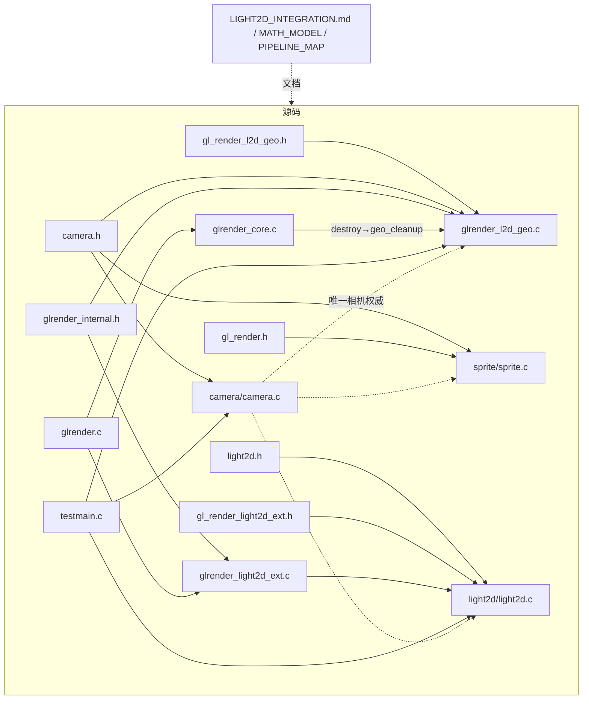

# LIGHT2D_PIPELINE_MAP.md — 维护者视角的管线结构、文件职责与风险矩阵

面向维护者（接入者请读 `LIGHT2D_INTEGRATION.md`，数学约定请读
`LIGHT2D_MATH_MODEL.md`）。所有行号对应 `light2d-hardening-v1.1` 分支工作树，
源码改动会使行号漂移——函数名/符号优先于行号。

基线：tag `light2d-baseline-v1` = commit `9ba19f4`（分支 linux-wayland-pipewire）。
本文件所在分支：`light2d-hardening-v1.1`。

---

## 1. 管线 A：构建、初始化与图形上下文

- 构建目标：`zcsr_module(glrender/light2d/camera 等)`（CMakeLists.txt:39-50
  的 `zcsr_module()` GLOB CONFIGURE_DEPENDS 收集 `modules/<name>/*.c`）；
  `camera.c/sprite.c` 无独立 lib，按 Q3 决定直编进消费方可执行文件
  （CMakeLists zcsr_test/zcsr_light2d_demo 的 target_sources；新的
  `test_light2d_math` 同样直编 camera.c）。
- 初始化顺序：`zcsr_gl_create`（glrender.c:24）→ platform → core →
  instanced → `zcsr_gl_l2d_init`（编译 radial/deferred/bloom/shadow/light
  五个 program、缓存 uniform、建 fsq VAO/VBO），任一失败按逆序回滚。
- geo 资源**不在** create 时初始化：`geo_begin` 首次调用时 `geo_ensure`
  惰性创建两个 program+VAO/VBO（glrender_l2d_geo.c:125-241），任一失败
  整组回滚重试（v1.1 修复，见风险矩阵 R1）。
- 失败路径真实性：shader 编译/链接失败 → stderr 日志 + 返回 false →
  create 返回 NULL（有报告路径）；**但调用方若忽略返回值继续画，
  GL 不会崩溃而是静默无渲染**——`u_ppu=0` 事故（Q4）即此类。
  构建成功 ≠ 渲染成功，验收必须读像素（tools/verify_light2d_shot.ps1）。
- 环境依赖：GL 3.3 Core（WGL/EGL/Cocoa 后端各一个文件）；MRT/浮点附件
  由 target_create 检查 completeness，失败干净报错。

## 2. 管线 B：相机与坐标投影

- 唯一权威：`zcsr_camera`（include/zcsr/camera.h，modules/camera/camera.c）。
  字段 center_x/center_y/px_per_unit/view_w/view_h/height_shear。
- 投影（CURRENT，camera.c world_to_px + geo VS + testmain project 镜像）：
  ```
  px = (x − cx)·ppu + W/2
  py = (y − cy − k·z)·ppu + H/2
  ```
- 消费方与 uniform 更新责任：
  - geo 两个 program：`geo_begin` 每帧重设 u_cam/u_ppu/u_k/u_view
    （视口取实时 GL_VIEWPORT）——**begin 时相机快照生效一帧**，
    begin 之后改相机下一帧才进 shader。
  - light2d 内部投影（光斑 quad、遮挡边、阴影挤出）在 draw_high 每帧
    从 `zcsr_l2d_effective_camera(ctx)` 现读——同为活指针，无第二套
    相机状态。
  - sprite.c 用 world_to_px（wz=0）——普通精灵在地面，与 geo 共享同一
    公式与同一相机实例；**精灵不带高度**（带高度精灵是未来需求）。
- 逆变换：`px_to_world` 恒为地面 z=0 反投影（鼠标语义，Math Model §3.3）。
- 无重复实现的风险点：testmain 的 `project()` 是 LOW 调试路径的宿主镜像，
  与 camera.c 公式逐项一致（test_light2d_math 断言覆盖）。

## 3. 管线 C：平色几何输入

- 契约：`zcsr_gl_l2d_geo_begin/face/end`（gl_render_l2d_geo.h）。
- 实现：glrender_l2d_geo.c——平色 program（VS 剪切投影+世界 varying，
  FS 四路输出），VAO/VBO 6 顶点（pos3+normal3），每 face 上传+一次
  glDrawArrays(GL_TRIANGLES,0,6)。
- 角点：边界顺序 4 点，拆 (0,1,2)+(0,2,3)。法线=整面一个世界轴法线。
- 错误行为：active 门卫 + 23 浮点 isfinite 校验 + 嵌套 begin 拒绝；
  失败返回 false，GL 状态由 begin/end 配对保证。
- 与纹理路径共享：begin/end 状态机、相机 uniform、G-buffer 绑定责任
  （都不碰 FBO）；独立：program、VAO/VBO、FS（平色 uniform vs 纹理采样
  +cutout）。

## 4. 管线 D：纹理几何输入

- 契约：`zcsr_gl_l2d_geo_tex_face`（同头文件；UV v0=图像顶、cutout<0.5、
  tint 与 texel 同在显示域相乘后直写 RGBA8 G0、emissive 不走纹理——
  细节见 INTEGRATION §5 与 MATH_MODEL §3.2）。
- 实现：第二个 program（共享剪切 VS+uv attribute；FS `texel*tint`，
  :92 `if (rgba.a < 0.5) discard;`），独立 VAO/VBO（8-float 顶点），
  纹理绑 unit 0（begin 存 GL_ACTIVE_TEXTURE+unit0 绑定，end 成对恢复
  :431-433）。
- 句柄解析：`zcsr_gl_find_tex`（glrender_core.c:220）→ entry->id；无效
  句柄在**任何 GL 调用前**返回 false（:388）。
- 两个 program 相机/视口 uniform 由 geo_begin 同步设置（:285-312，
  Q4 修复点）；v1.1 起 geo_ensure 要求两 program 齐备，否则整组回滚
  （R1 修复）。
- discard 与四附件一致性：被丢片元对所有 attachment 都不写，下层表面
  （painter 先序）数据完整——双 rug 探针证明。

## 5. 管线 E：G-buffer 与材质数据

创建/绑定/销毁：ext.c `target_create/resize/destroy`（事务式 resize）；
`gbuffer_begin` 清屏——Albedo/Emissive 零、Position (0,0,65504) 远哨兵
（空气不受光）、Normal (0.5,0.5,0,1)=中性朝上。

| 附件 | 格式 | 生产者 | 消费者 | 备注 |
|---|---|---|---|---|
| 0 Albedo | RGBA8 | geo 两 FS | 合成 FS（pow2.2 线性化→乘光照） | 全链路唯一线性化点 |
| 1 Position | RGBA16F | geo FS（世界 varying） | light FS（距离/射线） | 清屏远哨兵=空气 |
| 2 Normal | RGBA8 | geo FS（n*0.5+0.5） | light FS（**只读 xy**） | **D2：z 写而不读** |
| 3 Emissive | RGBA16F | geo FS（uniform） | 合成 FS（直加入受光项） | v1 非纹理 |

**D2 精确结论**：写入 `vec4(n*0.5+0.5,1)`（z 有值）；光照解码
`xy*2−1`，xy=(0,0)→朝上 (0,0,1)，否则 normalize(nx,ny,0)。
当前正确支持：朝上面、平面内立面（轴对齐类）。斜面：z 分量在光照时
被丢弃 → 漫反射按其在平面内投影计算（错误方向贡献）。
调试窗格（testmain dbg FS）显示的是**完整 3D**（含 z），仅供诊断。
触发改造条件：出现斜面/曲面需要正确 N·L 时——升级=光照解码改 3D +
geo 契约放开 normal 校验，G-buffer 格式不变。
discard 的附件一致性：cutout 在 FS 最前，四附件同生同灭，无部分写。

## 6. 管线 F：光源输入与光照计算

- 契约：`zcsr_light`（light2d.h）——x/y/height（世界）、radius/decay、
  dir_xyz+type（POINT/PARALLEL）、rgba（a=逐光强度）。
- 证据分级：
  - 点光（含高度/强度/衰减）：**运行验证**（v15-v19 探针、gain A/B）。
  - ray_shadows 点光：**运行验证**（proof 4/4 + 影子像素对算）。
  - 平行光：**代码在、从未有场景跑过** [已声明未确认]——shader 分支
    （u_parallel/u_dir3）、阴影沿 dir 平面投影、LOW 档跳过。
  - 2D 挤出掩码路径（shadows=on, ray=off）：执行不报错 [需运行时验证]。
- 消费链：light FS 采样 G-buffer Position(5)/Normal(6)/Shadow(8)；
  多光 BLEND ADD 累积进光缓冲（RGBA16F，25/50/100% 缩放）；无数量上限
  （数组上限已移除，draw-call 计数）；无排序问题（加法交换）。
- 环境光 0.03 与 pow2.2/x/(x+1) tonemap/^(1/2.2) 都在合成 FS——
  Math Model §6.5 记录实际顺序。

## 7. 管线 G：射线阴影与遮挡体

- 数据路径：遮挡体（世界单位凸多边形+属性）存 ctx 调用方缓冲 →
  draw_high 打包 footprint AABB+height 进 `u_Boxes[16]`（2 vec4/盒）→
  light FS `zcsr_ray_blocked` 逐片元 slab 测试（t∈(1e-4,1−1e-4)）。
- CPU 掩码路径并存：`zcsr_l2d_emit_occluders`（light2d.c）按属性选择
  边/面，挤出进 R8 掩码（MAX 混合），光照 FS 5-tap 采样。ray 与 mask
  的选择：点光+ray_shadows → FS 射线；平行光（无论 ray 开关）→ 掩码
  （light2d.c:727-729 掩码分支内 `use_shadow=1` ——本轮流查确认该组合
  正确，"parallel+ray 丢阴影"假设不成立）。
- **G1 逐参数裁决**（结论类型见执行令 §六）：
  - `factor`：结论 3。2D 掩码路径支持（逐遮挡体浓度）；ray 路径硬 1.0。
    light2d.h ray_shadows 注释已声明"2D extrusion mask is bypassed"，
    INTEGRATION 限制清单列出——文档不误导。
  - `distance`：结论 3。同上（2D=有限挤出带；ray=无限楔形，AABB 无
    拖尾语义）。
  - `reverse`：结论 3。同上。
  - `self_shadow`：结论 3。同上（ray 路径多边形本身不进掩码）。
  - 无一项属于结论 2（已承诺但缺陷）——契约文字与实现一致。
  - 未来若宿主需要 ray 路径支持这些属性：factor=乘进 FS 遮挡返回值；
    distance/reverse/self 需要把 2D 掩码与射线混合或改遮挡表示——
    属新设计，等待需求。
- alpha 与遮挡分离：纹理 alpha 永不生成遮挡体（两文档一致声明）。

## 8. 管线 H：合成、后处理与窗口显示

pass 顺序（HIGH）：阴影掩码（每光）→ 光累积缓冲（ADD，逐光）→
**bind_default_target（v15 修复点——历史黑屏根因即缺此步）**→
deferred 或 bloom FS 全屏合成 → 窗口。状态：合成用 OPAQUE blend；
gbuffer/lightbuf/shadow 各自 FBO 切换都经 begin/end 配对或显式重绑。
调试窗格：在合成之后画，会临时改 viewport+disable blend，自己恢复；
采样前重绑 G-buffer（end_lighting 的 state_pop 会清 4-8 单元）。
LOW 档：无 G-buffer，加法光斑直接叠在宿主画面上（调试级）。
bloom：合成变体（9-tap 亮度门控），options.bloom 切换，运行验证过
（B 键）。gamma/tonemap：合成 FS 内 pow2.2 → x/(x+1) → ^(1/2.2)，
无独立后处理 pass。

## 9. 管线 I：资源生命周期与 GL 状态

| 资源 | 创建 | 所有者 | 销毁 | 失效行为 |
|---|---|---|---|---|
| renderer 本体 | 宿主 buffer | 宿主 | zcsr_gl_destroy | — |
| G-buffer MRT | light2d create | ctx | ctx destroy / resize(事务) | resize 失败保留旧目标 |
| 光/影累积缓冲 | ext ensure_* | renderer | renderer destroy | 自动重建 |
| geo program/VAO/VBO×2 | geo_ensure 惰性 | renderer | core_destroy→cleanup | v1.1：部分失败整组回滚重试 |
| 宿主纹理 | 宿主 create | **宿主** | 宿主 destroy | tex_face 拒绝并 false |
| 遮挡体数据 | 宿主调 add_occluder | ctx 调用方缓冲 | clear/ctx destroy | — |
| 相机 | 宿主栈/成员 | **宿主**（活指针） | 宿主 | 生命周期须覆盖 ctx 使用期 |

GL 状态契约表：见 LIGHT2D_INTEGRATION.md §6（逐行号），本表不重复。
跨管线污染风险：geo begin/end 配对之外无状态泄漏点；dbg 窗格自恢复；
合成前后 blend 模式均显式设置。

## 10. 管线 J：调试、集成与宿主接入

- `integration/testmain.c` = 验收夹具（程序化 rug 纹理、proof、dbg 窗格），
  **不是正式游戏架构**；window.c 壳与模块注册是集成脚手架。
- `tools/verify_light2d_shot.ps1` = 截图探针验收（预期 RGB 表在
  INTEGRATION §8）；`tests/test_light2d_math.c` = 纯 CPU 数学 ctest
  （D3 交付，24 断言）；shadow proof 在 autoquit stdout（自动化断言）。
- 无真实 2D 宿主（2048/FPS 明确不改造）；接入步骤 = INTEGRATION §9。
- 宿主集成限制：几何阶段专属调用、painter 排序责任、q 键限制——
  INTEGRATION §4/§7。

---

## 11. 文件分组（组→文件）

1. **公共契约**：include/zcsr/light2d.h、gl_render_light2d_ext.h、
   gl_render_l2d_geo.h、camera.h、transform.h、sprite.h（后三者同时服务
   组 2/3）
2. **相机与投影**：modules/camera/camera.c（共享文件：被 geo、sprite、
   light2d、testmain 四方消费）
3. **几何输入**：modules/glrender/glrender_l2d_geo.c；modules/sprite/sprite.c
   （地面精灵，共享组 2）
4. **G-buffer 与材质**：glrender_l2d_geo.c（FS 写入方，共享组 3）+
   glrender_light2d_ext.c 的 target_*/gbuffer_begin（创建清屏方，共享组 6）
5. **光源与光照**：modules/light2d/light2d.c + glrender_light2d_ext.c 的
   light program
6. **阴影与遮挡**：light2d.c（emit_occluders/打包）+ ext.c（shadow
   program/mask RT + light FS 的 zcsr_ray_blocked）
7. **合成与显示**：ext.c（deferred/bloom program、lightbuf、
   bind_default_target）+ glrender.c（create/destroy 编排）
8. **渲染器内部资源与生命周期**：glrender_internal.h、glrender_core.c
   （纹理表/white tex/geo cleanup 挂点）、glrender.c
9. **调试/验收/宿主**：integration/testmain.c、integration/window.c（壳）、
   tools/verify_light2d_shot.ps1、tests/test_light2d_math.c、
   build-msvc/shot.ps1（工具的构建目录副本）
10. **构建与配置**：CMakeLists.txt、windows/zcsr.rc
11. **文档与基线**：LIGHT2D_INTEGRATION.md、LIGHT2D_PIPELINE_MAP.md、
    LIGHT2D_MATH_MODEL.md、tag light2d-baseline-v1

## 12. 渲染数据流图

```mermaid
flowchart LR
  subgraph HOST[宿主帧]
    CAM[zcsr_camera 活指针] --> GEO
    GEO[geo_begin/face/tex_face/end] -->|世界角点+法线+材质| GB
    L2D[light2d begin_geometry] --> GB
  end
  GB[G-buffer MRT: Albedo RGBA8 / Position RGBA16F 世界 / Normal RGBA8 / Emissive RGBA16F]
  OCC[遮挡体 footprint+H] --> SH[阴影: 点光=FS slab射线 / 平行光+属性=2D掩码挤出]
  LIGHTS[zcsr_light 3D点光/平行光] --> LB[光累积 RGBA16F ADD]
  GB --> LB
  SH --> LB
  LB --> COMP[合成: bind_default_target → albedo^2.2×(emissive+light+0.03) → x/(x+1) → ^(1/2.2)]
  COMP --> WIN[默认窗口目标 → 宿主 HUD]
```

## 13. 文件依赖图



- 唯一权威数据源：相机=cam 实例；k=height_shear 字段；alpha 阈值=
  geo_tex_fs:92 一处；遮挡体=ctx 注册表。
- 直接改 GL 状态的模块：glrender_l2d_geo.c（表见 INTEGRATION §6）、
  glrender_light2d_ext.c（管线内部配对）、testmain dbg 窗格（自恢复）。
- 测试程序不得成为模块依赖：camera/sprite 直编进 exe 的现状是历史
  决定（Q3 令），若未来建 lib 需单独立项。

## 14. 风险矩阵

| ID | 等级 | 位置 | 实际行为 | 预期/依据 | 证据 | 影响 | 处理 | 本次 |
|---|---|---|---|---|---|---|---|---|
| R1 | **P1** | glrender_l2d_geo.c :126 门卫/:406 tex_face | 平色建成功+纹理建失败→ensure 早退 true→tex_face glUseProgram(0) 静默无渲染 | 契约：失败必须可见（false），u_ppu=0 同类教训 | 源码走查（本轮） | 纹理路径 | **已修**：门卫要求双 program+失败整组回滚+tex_face 守卫 | ✅ |
| R2 | P2 | light2d.h ray_shadows 注释 vs 实现 | ray 路径忽略 factor/distance/reverse/self_shadow | G1 裁决=结论 3（文档已声明，非缺陷） | 源码走查+契约对照 | 阴影表现 | 保持文档；触发=宿主要求 | 登记 |
| R3 | P2 | ext.c light FS 法线解码 | Normal.z 写而不读（D2） | 斜面 N·L 需 3D 解码 | 源码+窗格对照 | 斜面光照 | 能力说明（MATH_MODEL §4.3）；触发=斜面需求 | 登记 |
| R4 | P2 | 测试覆盖 | light2d 视觉路径无自动断言（D3 部分缓解：数学 ctest 24 断言；视觉仍靠探针） | 回归保护 | ctest 23 项 | 回归 | 已加 test_light2d_math；视觉探针流程固化 | ✅部分 |
| R5 | P2 | ext.c parallel 光分支 | 平行光从未有场景运行 [已声明未确认] | 证据分级要求 | 源码在/无运行证据 | 平行光用户 | 等真实需求+场景 | 登记 |
| R6 | P2 | light2d.c LOW 档 | LOW=加法色斑/调试色块，非完整光照 | 契约注明"调试级" | 源码 | LOW 用户 | 维持；宿主用 HIGH | 登记 |
| R7 | P3 | testmain project() | LOW 镜像投影与 camera.c 公式重复实现 | 单一权威原则 | test_light2d_math 断言两侧一致 | 维护成本 | 相机无 lib 前维持；建 lib 时收敛 | 登记 |
| R8 | P3 | 排序 | 无深度附件，painter order 责任在宿主，q 键仅参考 | INTEGRATION §4 已注明 | 源码（FBO 无深度附件） | 复杂遮挡场景 | 等宿主需求 | 登记 |
| R9 | P3 | light2d.c 2D 掩码路径 | mask 路径（含 5-tap/属性）运行过但无独立视觉验证记录 | 证据分级 | gain A/B 间接 | 默认路径用户 | 需要时补场景 | 登记 |

P0：无（当前未发现数据损坏/崩溃/生命周期错误级问题）。
